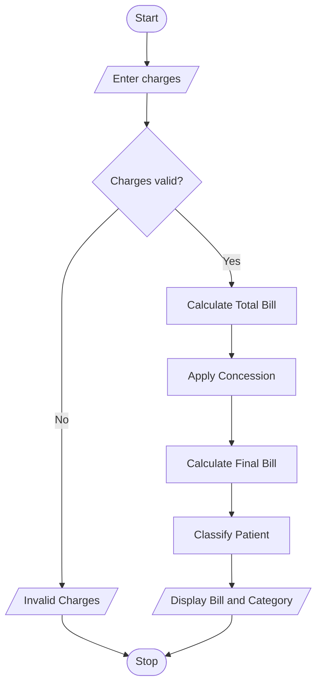

# 3. Hospital Billing and Patient Classification Using Python

## 1. Problem Statement
3. Hospital Billing and Patient Classification: Process consultation, diagnostic, and treatment charges, apply conditional concessions, validate billing constraints, and classify patients according to a supplied payment policy.

## 2. Algorithm

1. Start the program.
2. Read consultation, diagnostic, and treatment charges.
3. Check whether any charge is negative.
4. If a charge is negative, display an invalid billing message and stop.
5. Calculate the total bill by adding all three charges.
6. If the total bill is ₹10,000 or more, calculate a 10% concession.
7. Limit the concession to a maximum of ₹2,000.
8. Calculate the final bill by subtracting the concession from the total bill.
9. Classify the patient according to the final payable amount.
10. Display the total bill, concession, final amount, and patient classification.
11. Stop the program.

## 3. Flowchart

## 5. Sample Input

Enter consultation charges: ₹1500
Enter diagnostic charges: ₹2500
Enter treatment charges: ₹8000

## 6. Sample Output

----- HOSPITAL BILL -----
Consultation Charges: ₹1500.00
Diagnostic Charges:   ₹2500.00
Treatment Charges:    ₹8000.00
Total Bill:           ₹12000.00
Concession:           ₹1200.00
Final Payable Amount: ₹10800.00
Patient Classification: Medium Payment

