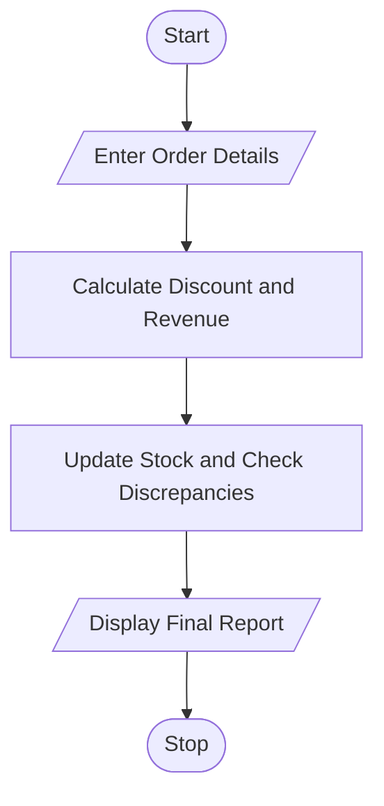

# 99. Integrated E-Commerce Order Processing and Reconciliation Using Python

## 1. Problem Statement

Write a Python program to process e-commerce orders, apply discounts, manage dispatches and returns, update stock quantities, calculate revenue, identify discrepancies, and generate a final inventory report.

## 2. Algorithm

1. Start.
2. Enter product details, prices, stock, and order quantities.
3. Calculate order values and apply discounts.
4. Process dispatches and returns.
5. Update stock and calculate net revenue.
6. Compare expected stock with actual stock.
7. Display revenue, discrepancies, and final inventory.
8. Stop.

## 3. Flowchart 

## 5. Sample Input

Enter number of products: 2

Enter details for product 1
Product name: Laptop
Price: 40000
Initial stock: 10
Ordered quantity: 1
Dispatched quantity: 1
Returned quantity: 0
Actual stock: 9

Enter details for product 2
Product name: Mouse
Price: 600
Initial stock: 20
Ordered quantity: 10
Dispatched quantity: 8
Returned quantity: 2
Actual stock: 13

## 6. Sample Output

--- E-COMMERCE AUDIT REPORT ---
Total Net Revenue: Rs. 39240.0

Product: Laptop
Net Revenue: Rs. 36000.0
Expected Stock: 9
Actual Stock: 9
Inventory: Matched

Product: Mouse
Net Revenue: Rs. 3240.0
Expected Stock: 14
Actual Stock: 13
Discrepancy: -1 units

--- FINAL INVENTORY SUMMARY ---
Laptop : 9 units expected
Mouse : 14 units expected

