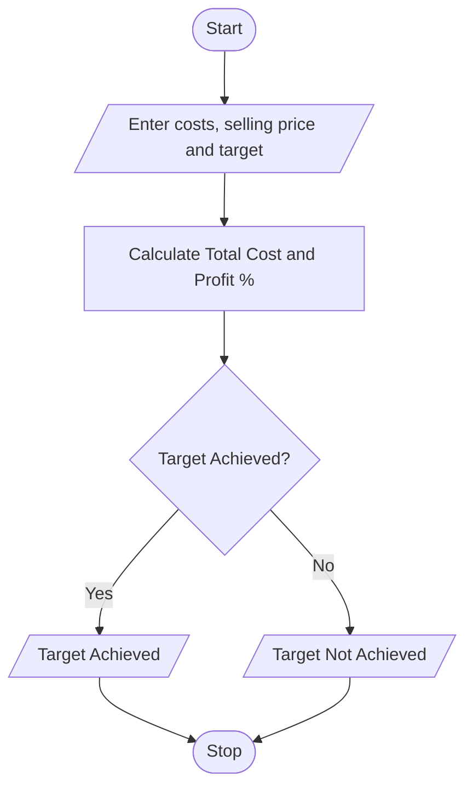

# 8. Manufacturing Cost and Profitability Analysis Using Python

## 1. Problem Statement

Write a Python program to calculate the total manufacturing cost by considering material costs, labour charges, wastage costs, and machine costs. Calculate the profit using the selling price, determine the profit percentage, and check whether the production meets the specified profit target.

## 2. Algorithm

1. Start.
2. Enter material cost, labour charges, wastage cost, machine cost, selling price, and profit target percentage.
3. Validate that all input values are non-negative.
4. Calculate total manufacturing cost.
5. Calculate profit by subtracting manufacturing cost from selling price.
6. Calculate profit percentage.
7. Compare the profit percentage with the target percentage.
8. Display the total cost, profit, profit percentage, and result.
9. Stop.

## 3. Flowchart 

## 5. Sample Input

Enter material cost: 5000
Enter labour charges: 2000
Enter wastage cost: 500
Enter machine cost: 1500
Enter selling price: 12000
Enter target profit percentage: 30

## 6. Sample Output

--- Manufacturing Report ---
Total Manufacturing Cost: 9000.0
Selling Price: 12000.0
Profit/Loss: 3000.0
Profit Percentage: 33.33 %
Result: Profit Target Achieved

Calculation:
- Total cost = 5000 + 2000 + 500 + 1500 = ₹9,000
- Profit = ₹12,000 − ₹9,000 = ₹3,000
- Profit percentage = (3000 / 9000) × 100 = 33.33%
- Since 33.33% is greater than the 30% target, the profit target is achieved.
