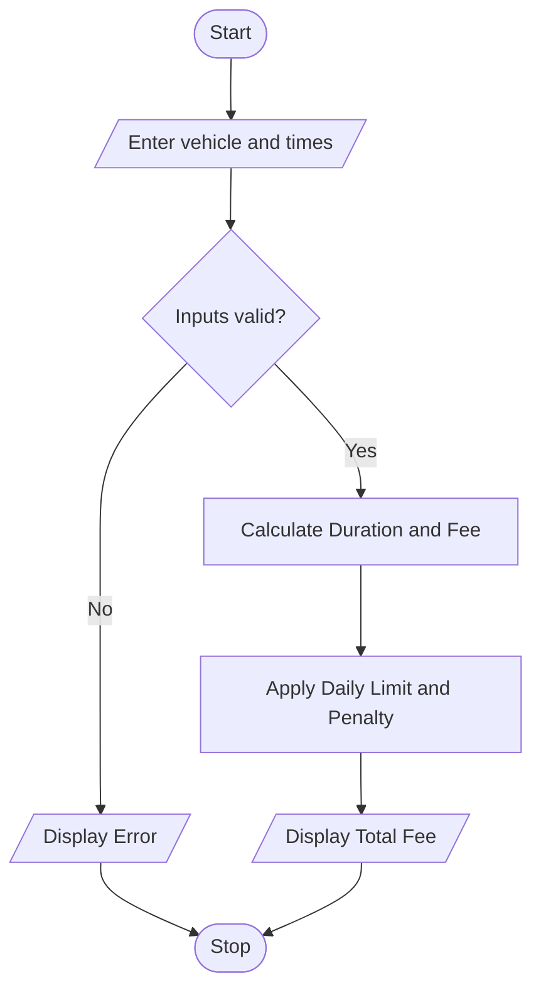

# 15. Smart Parking Fee Management Using Python

## 1. Problem Statement

Write a Python program to calculate parking fees based on vehicle category, entry time, exit time, overnight parking, daily fee limits, and penalty conditions. Validate the time inputs and display the total parking fee.

## 2. Algorithm

1. Start.
2. Enter the vehicle category, entry time, and exit time.
3. Validate the vehicle category and time format.
4. Calculate the parking duration, including overnight parking.
5. Calculate the charge based on the vehicle category and started hours.
6. Apply the daily maximum limit.
7. Add the penalty if parking exceeds 24 hours.
8. Display parking duration and total fee.
9. Stop.

## 3. Flowchart 

## 5. Sample Input

Enter vehicle type (two-wheeler/car/heavy): car
Enter entry date and time (YYYY-MM-DD HH:MM): 2026-10-28 22:00
Enter exit date and time (YYYY-MM-DD HH:MM): 2026-10-29 02:30

## 6. Sample Output

--- PARKING BILL ---
Vehicle Type: car
Parking Duration: 5 hours
Parking Fee: Rs. 200
Penalty: Rs. 0
Total Parking Fee: Rs. 200

Calculation:

- Parking duration = 4 hours 30 minutes, rounded up to 5 hours.
- Parking fee = 5 × ₹40 = ₹200.
- Penalty = ₹0 because parking did not exceed 24 hours.
- Total parking fee = ₹200.
