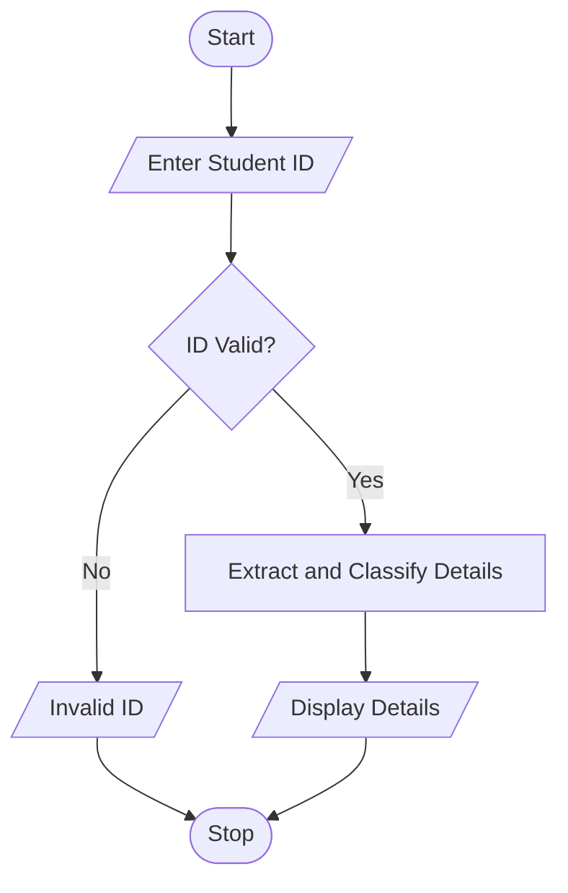

# 33. Campus Registration Identifier Analyzer Using Python

## 1. Problem Statement

Write a Python program to analyze student registration IDs, validate their format, extract the admission year, branch code, and student number, and classify students according to their branch and admission year.

## 2. Algorithm

1. Start.
2. Enter the student registration ID.
3. Check whether the ID contains exactly nine characters.
4. Validate the admission year, branch code, and student number.
5. If invalid, display an error message.
6. If valid, extract the year, branch, and student number.
7. Classify the student by branch and admission year.
8. Display the extracted details and classification.
9. Stop.

## 3. Flowchart 

## 5. Sample Input

Enter Student ID (YYBBBSSSS): 26CSE0196

## 6. Sample Output

--- STUDENT DETAILS ---
Admission Year: 2026
Branch: CSE
Student Number: 0196
Classification: CSE 2026 Batch

