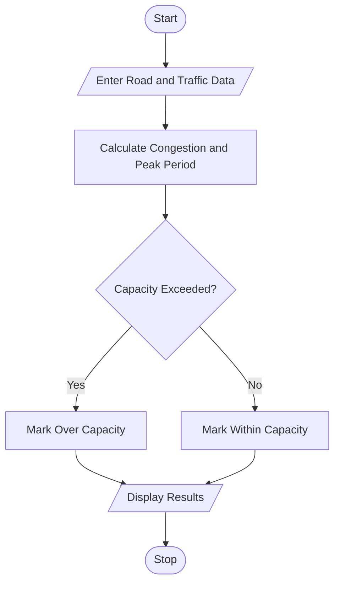

# 40. Traffic Flow and Congestion Analysis Using Python

## 1. Problem Statement

Write a Python program to analyze vehicle counts across multiple roads and time intervals. Identify the peak traffic period, classify congestion levels, and determine which roads exceed their traffic capacity.

## 2. Algorithm

1. Start.
2. Enter the number of roads and time intervals.
3. Enter each road's name, capacity, and vehicle counts for each interval.
4. Calculate congestion percentage for each interval.
5. Classify congestion as low, moderate, or high.
6. Identify the peak traffic period.
7. Check whether each road exceeds its capacity.
8. Display the results.
9. Stop.

## 3. Flowchart 

## 5. Sample Input

Enter number of roads: 2
Enter number of time intervals: 3
Enter time intervals separated by spaces: 9AM 1PM 6PM

Enter road name: Road A
Enter road capacity: 100
Enter vehicle counts for each interval: 30 60 90

Enter road name: Road B
Enter road capacity: 80
Enter vehicle counts for each interval: 20 50 100

## 6. Sample Output

--- TRAFFIC ANALYSIS ---
Peak Traffic Period: 6PM

Road: Road A
Maximum Vehicles: 90
Congestion: High
Status: Within Capacity

Road: Road B
Maximum Vehicles: 100
Congestion: High
Status: Capacity Exceeded

