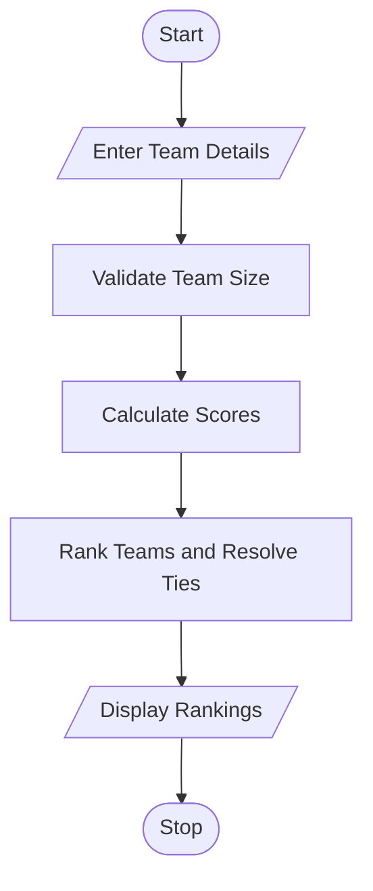

  

# 52. Hackathon Team Formation and Ranking

## 1. Problem Statement

Write a Python program to form hackathon teams, validate team sizes, calculate total scores from multiple rounds, and rank teams based on their scores. If two teams have the same total score, use the highest score in the final round to decide the ranking.

## 2. Algorithm

1. Start the program.
2. Enter the number of teams and the minimum and maximum team sizes.
3. Enter each team's name, member count, and scores for three rounds.
4. Validate the team size.
5. Calculate each team's total score.
6. Sort teams by total score in descending order.
7. If totals are tied, compare final-round scores.
8. Display valid teams and their rankings.
9. Stop the program.

## 3. Flowchart 

## 5. Sample Input

Enter number of teams: 3

Team 1
Enter team name: Alpha
Enter number of members: 3
Enter Round 1 score: 80
Enter Round 2 score: 85
Enter Round 3 score: 90

Team 2
Enter team name: Beta
Enter number of members: 2
Enter Round 1 score: 85
Enter Round 2 score: 85
Enter Round 3 score: 95

Team 3
Enter team name: Gamma
Enter number of members: 5

## 6. Sample Output

Invalid team size! Team rejected.

--- Hackathon Rankings ---
1 Beta | Members: 2 | Total Score: 265 | Final Round: 95
2 Alpha | Members: 3 | Total Score: 255 | Final Round: 90

