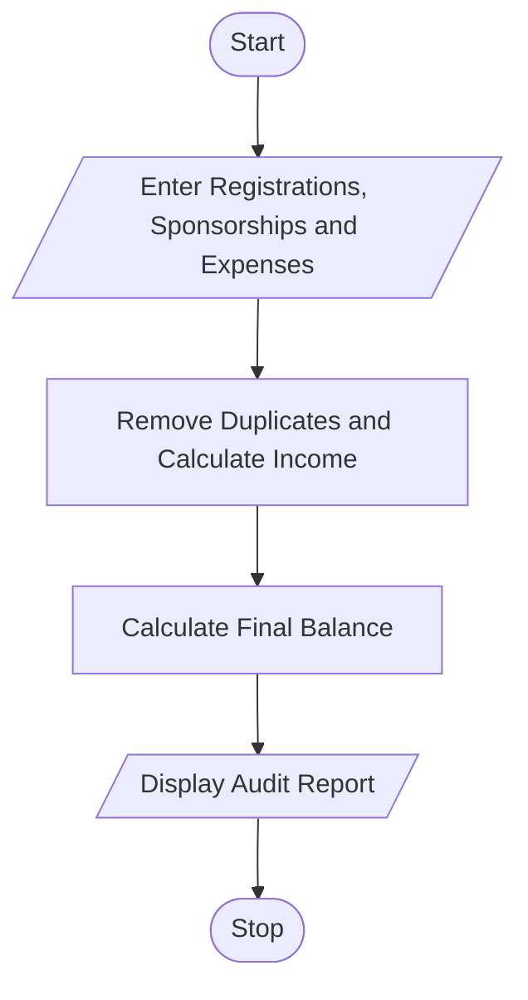

# 74. Campus Festival Registration and Financial Audit Using Python

## 1. Problem Statement

Write a Python program to manage campus festival registrations and perform a financial audit. The program should maintain participant registration IDs, detect duplicate registrations, calculate total registration fees and sponsorship contributions, calculate total expenses, and determine the final financial balance.

## 2. Algorithm

1. Start.
2. Enter participant registration IDs.
3. Check for duplicate IDs and count valid participants.
4. Calculate total registration fees.
5. Enter sponsorship contributions and festival expenses.
6. Calculate total income and final financial balance.
7. Display valid participants, duplicate registrations, income, expenses, and balance.
8. Stop.

## 3. Flowchart 

## 5. Sample Input

Enter number of registrations: 4
Enter registration ID: 101
Enter registration ID: 102
Enter registration ID: 101
Enter registration ID: 103
Enter number of sponsorships: 2
Enter sponsorship amount: 2000
Enter sponsorship amount: 1000
Enter number of expenses: 2
Enter expense amount: 1200
Enter expense amount: 800

## 6. Sample Output

--- FESTIVAL AUDIT REPORT ---
Valid Participants: 3
Duplicate Registrations: ['101']
Registration Income: Rs. 1500
Sponsorship Contributions: Rs. 3000.0
Total Income: Rs. 4500.0
Total Expenses: Rs. 2000.0
Final Financial Balance: Rs. 2500.0
Status: Profit

Calculation:
- Registration income = 3 × ₹500 = ₹1,500
- Total income = ₹1,500 + ₹3,000 = ₹4,500
- Final balance = ₹4,500 − ₹2,000 = ₹2,500 profit
