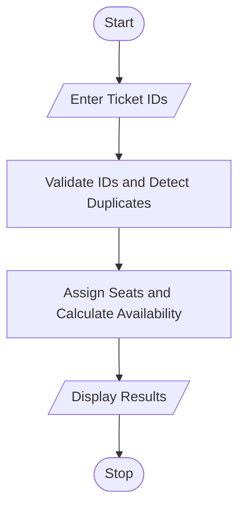

# 81. Campus Event Seating and Entry Validation Using Python

## 1. Problem Statement

Write a Python program to assign seats to registered participants using nested lists. Validate tickets using registration IDs, detect duplicate entries, and calculate the remaining seating capacity.

## 2. Algorithm

1. Start.
2. Create a nested list of seats and registration IDs.
3. Enter the ticket registration ID.
4. Validate the ID against registered participants.
5. Reject invalid IDs and detect duplicate entries.
6. Assign a seat to each valid entry.
7. Calculate available seating capacity.
8. Display seat assignments, duplicate entries, and remaining seats.
9. Stop.

## 3. Flowchart 

## 5. Sample Input

Enter number of tickets to check: 5
Enter registration ID: 101
Enter registration ID: 102
Enter registration ID: 101
Enter registration ID: 110
Enter registration ID: 103

## 6. Sample Output

--- EVENT SEATING REPORT ---
Seat Assignments:
Row 1 : ['101', '102', '103']
Row 2 : [None, None, None]
Valid Entries: 3
Duplicate Entries: ['101']
Invalid Tickets: ['110']
Available Seats: 3

