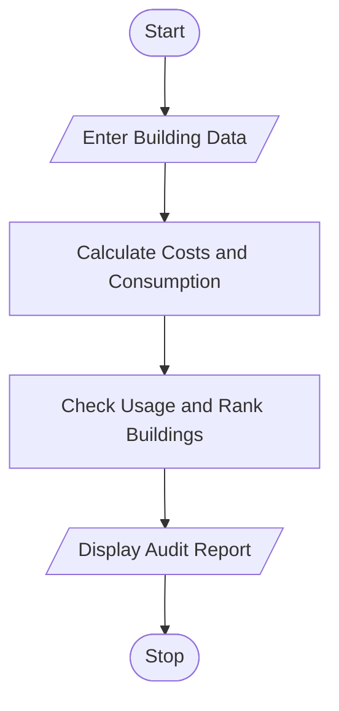

# 90. Integrated Campus Energy and Water Audit Using Python

## 1. Problem Statement

Write a Python program to analyze electricity and water consumption across multiple campus buildings over two days. Calculate consumption costs and percentage changes, identify buildings with excessive consumption, and rank buildings using a scoring method.

## 2. Algorithm

1. Start.
2. Enter building names and electricity and water consumption for two days.
3. Calculate electricity and water costs.
4. Calculate percentage changes from Day 1 to Day 2.
5. Identify buildings exceeding consumption limits.
6. Calculate scores and rank buildings.
7. Display costs, percentage changes, excessive consumption alerts, and rankings.
8. Stop.

## 3. Flowchart

## 5. Sample Input

Enter number of buildings: 2

Enter building name: Admin
Day 1 electricity units: 80
Day 2 electricity units: 120
Day 1 water litres: 400
Day 2 water litres: 600

Enter building name: Library
Day 1 electricity units: 60
Day 2 electricity units: 70
Day 1 water litres: 300
Day 2 water litres: 350

## 6. Sample Output

--- CAMPUS AUDIT REPORT ---

Building: Admin
Day 2 Total Cost: Rs. 2160.0
Cost Change: 50.0 %
Score: 126.0
Consumption: Excessive

Building: Library
Day 2 Total Cost: Rs. 1260.0
Cost Change: 16.67 %
Score: 73.5
Consumption: Normal

--- BUILDING RANKING ---
1 Admin - Score: 126.0
2 Library - Score: 73.5

Calculation:
- Day 2 cost = (Electricity × ₹8) + (Water × ₹2).
- Cost percentage change = \\((\text{Day 2 cost} - \text{Day 1 cost}) / \text{Day 1 cost} \times 100\\).
- Score = Electricity units + Water litres ÷ 100.
- Admin ranks first because it has the higher score and exceeds the consumption limits.
